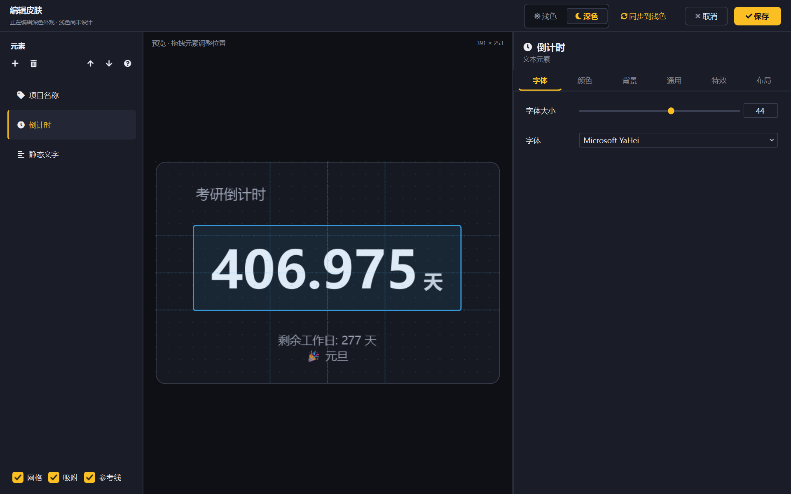
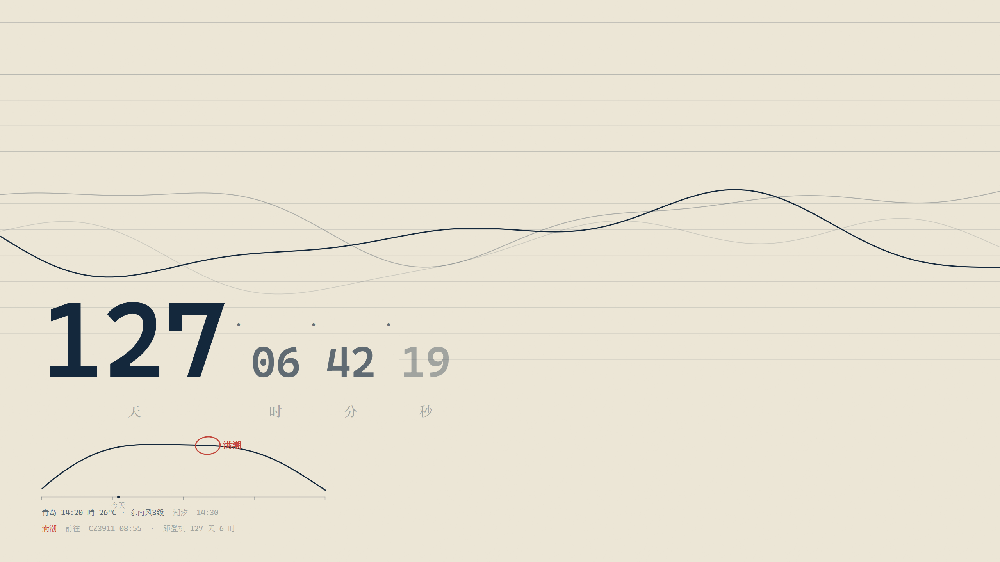
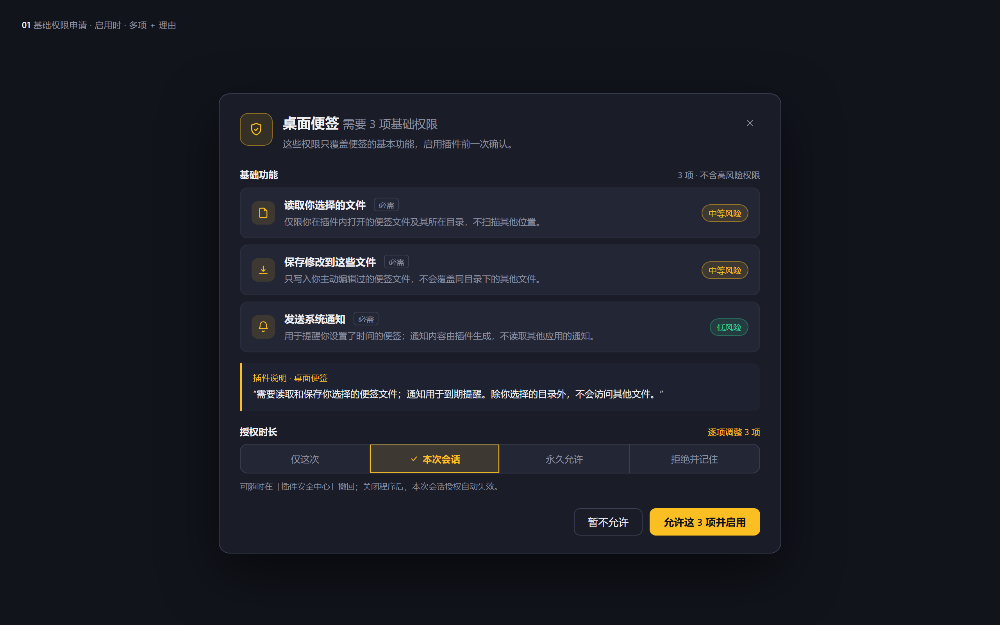
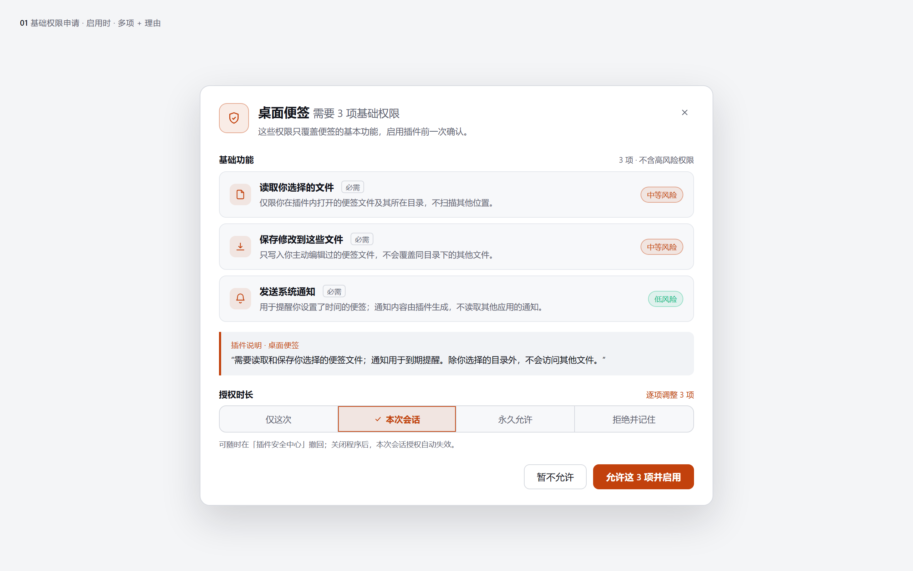
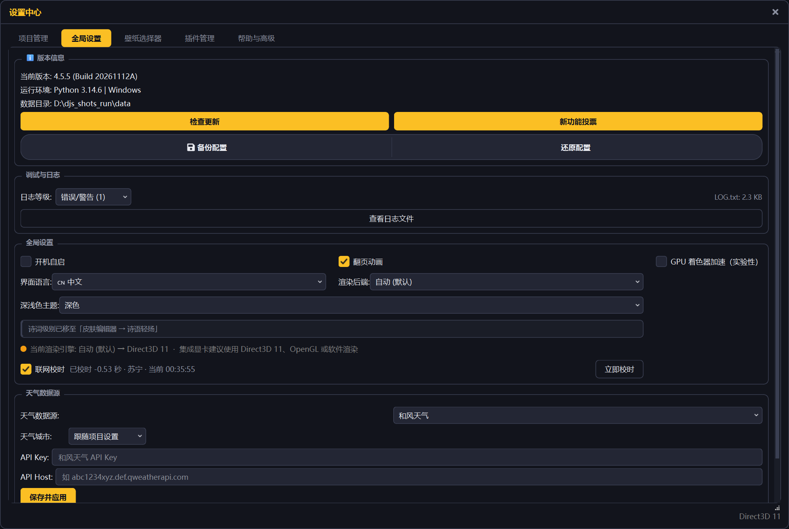
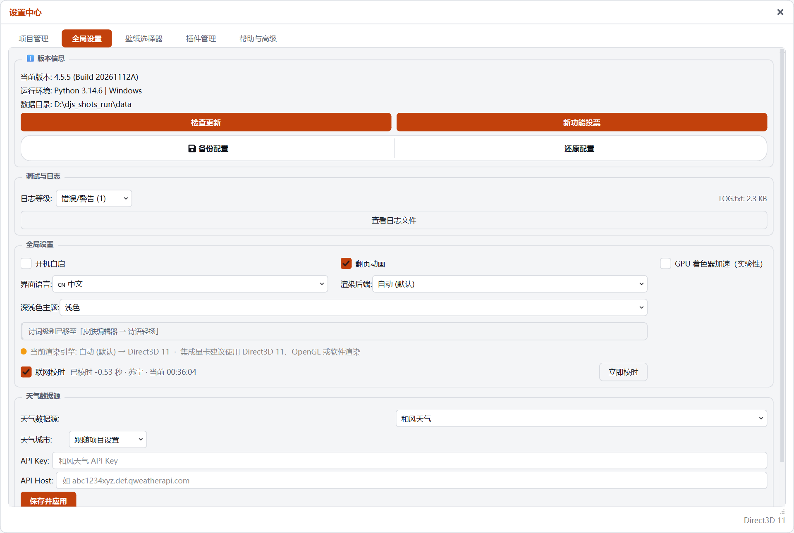
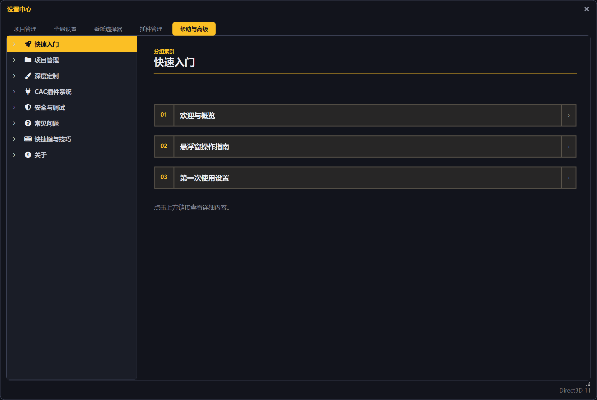
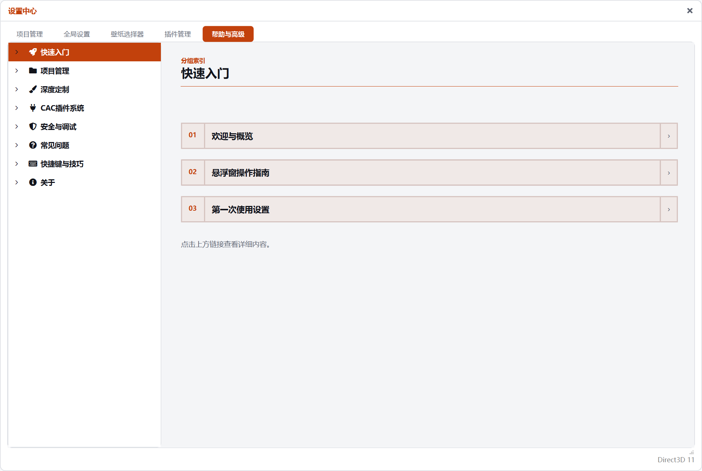

<p align="center">
  
</p>

<p align="center">
  <a href="https://github.com/GuZhi-233/Countdown-DJS/releases/latest"></a>
  <a href="LICENSE"></a>
  
  
</p>

# 倒计时 · DJS

上课前 2 分钟，桌面上的悬浮窗会展开提醒；下课时间到，按项目设置播放提示音。每个倒计时项目是一张独立悬浮窗，位置、大小、字体和背景分别保存。当前版本 <span style="color:#1F883D"><b>4.5.5</b></span>，运行在 <span style="color:#1F883D">Windows 10 / 11 x64</span>。

> ZX 插件、Windows / Android 远控控制台放在附属仓库：
> **[Countdown-DJS-Addons](https://github.com/GuZhi-233/Countdown-DJS-Addons)**  
> Gitee 镜像：[Countdown-DJS-Addons](https://gitee.com/guzhi233/Countdown-DJS-Addons)

<p align="center">
  
  
</p>

<p align="center"><i>同一项目在深色与浅色下的实际渲染</i></p>

---

## 功能

<h3> 多项目与循环倒计时</h3>

- 每个项目一张独立悬浮窗，目标时间精确到分钟。
- 自然日与工作日两种显示方式，内置中国法定节假日和调休数据。
- 循环项目支持每周、每月、每年重复，自动计算下一次触发时间。
- 支持到期闪烁、结束提示音与考试模式。
- 项目配置保存在 `data/countdown_config.json`，窗口位置与尺寸随项目一起保存。

<h3> 外观、皮肤与布局</h3>

- 背景支持纯色、图片（含 GIF）、渐变、动态壁纸和壁纸轮播。
- 动态背景共 5 种：星空、鼠标粒子、极光、天空、潮汐。极光与天空优先使用 OpenGL + GLSL，驱动不支持时回退 CPU。
- 皮肤库按项目保存，支持浅色 / 深色两套外观与跟随系统切换。
- 布局编辑器可拖拽元素、调整层级、吸附网格、用方向键微调位置与大小。
- 项目名称、倒计时、静态文字等元素可分别设置字体、颜色、透明度、描边、阴影和背景。



<h3> 全屏与独立控件</h3>

- 一键进入全屏，动态壁纸可选 30 / 60 / 120 帧与四档画质。
- 全屏布局按背景类型分别保存，切换背景时恢复各自的位置。
- 全屏内可以直接选中元素、拖动、缩放、调整透明度和显隐。
- 支持翻页时钟与登机牌样式的全屏信息布局。
- 天气、番茄钟、诗词三类独立控件可脱离主窗口存在，支持拖动、缩放、置顶、鼠标穿透和移除。



<h3> 插件系统与安全中心</h3>

- CAC 插件系统支持动态背景、桌面挂件、设置页、卡片插槽、事件钩子和公开服务。
- 插件运行在独立子进程，清单 v2 把权限分为基础权限与按需权限。
- 共 24 个权限位，覆盖文件、网络、命令、剪贴板、注册表、开机启动等能力。
- 安全中心有 8 个标签页：拦截记录、放行记录、文件操作、插件权限管理、敏感记录、插件日志、防护管理、信任模式。
- 插件系统默认关闭。插件文件放入 `plugins` 目录后，需要在设置中手动启用并授权。

<p align="center">
  
  
</p>

<h3> 教室远程控制（附属仓库）</h3>

- ZX 插件安装到主程序 `plugins` 目录，电脑端监听 `48700` 端口并通过 `48690` 端口广播发现。
- Windows 与 Android 控制台可同时连接多台电脑，分别修改课程表。
- 教师通知支持单台发送，也支持勾选多台群发。
- 已配对设备启动时自动重连，设备详情里可以改备注、重连或解除配对。
- 主程序安装包不包含 ZX 插件，需要从 [附属仓库](https://github.com/GuZhi-233/Countdown-DJS-Addons/releases/latest) 单独下载。

<h3> 调试、托盘与数据</h3>

- 设置界面按 `~` 或 `` ` `` 呼出调试控制台，支持 Python 表达式、Tab 补全和 20 多个内置命令。
- 托盘菜单可显示 / 隐藏所有窗口、重置窗口位置、切换鼠标穿透与考试模式、更新假期数据。
- 支持开机启动与联网校时；校时启动后执行一次，之后每 30 分钟校准一次。
- 备份与还原会把项目、皮肤、壁纸列表和独立控件写入 `data/backups/`。
- 界面支持中文与 English，部分界面需要重启后生效。

<p align="center">
  
  
</p>

<h3> 内置帮助</h3>

- 帮助中心包含 8 个分组、45 个主题，覆盖倒计时、外观、全屏、插件、安全中心和常见问题。
- 帮助正文随界面语言切换，支持深色与浅色主题。
- 插件开发示例提供可直接运行的课堂提醒插件，包含清单 v2、卡片插槽、设置页和按需权限。

<p align="center">
  
  
</p>

---

## 下载与安装

| 内容 | 地址 |
| --- | --- |
| 主程序安装包 / 便携版 | [GitHub Releases](https://github.com/GuZhi-233/Countdown-DJS/releases/latest) |
| ZX 插件、Windows / Android 控制台 | [附属仓库 Releases](https://github.com/GuZhi-233/Countdown-DJS-Addons/releases/latest) |

- 系统：Windows 10 / 11 x64。
- 运行库：需要 Visual C++ 2015-2022 x64。
- 安装位置：默认安装到当前用户目录，不写入 `Program Files`，不需要管理员权限。
- 主程序安装包约 <b>57 MB</b>，便携版约 <b>80 MB</b>。

安装后从桌面或开始菜单启动。ZX 插件与控制台按附属仓库 README 的步骤单独安装。

---

## 从源码运行

```bash
git clone https://github.com/GuZhi-233/Countdown-DJS.git
cd Countdown-DJS
pip install -r requirements.txt
python src/djs_pyqt6.py
```

请从仓库根目录运行。程序会在当前目录读取 `data`，并自动创建 `plugins` 目录。

可选依赖：

- `numpy`：极光背景的 CPU 回退渲染
- `Pillow`：图片背景增强
- `chinese_calendar`：节假日数据回退
- `psutil`：调试控制台的性能监控命令

---

## 已知限制

- 主程序只提供 Windows 桌面端；Android 端目前只有远控控制台，不是独立的倒计时应用。
- 远程控制要求手机 / 电脑与教室电脑在同一局域网。端口被防火墙拦截时无法连接。
- 插件系统默认关闭，没有在线插件市场。插件需要自行放入 `plugins` 并授权。
- GPU 动态背景依赖 OpenGL 3.3。显卡驱动不支持时自动回退 CPU，帧率会下降。
- 不提供云同步和账号体系，配置只保存在本机。
- 卸载程序会删除安装时写入的文件，但不会自动删除你自己创建的项目配置与备份。

---

## 目录结构

| 路径 | 内容 |
| --- | --- |
| `src/djs_pyqt6.py` | 主程序 |
| `data/` | 帮助、语言、诗词、节假日、提示音、背景预览 |
| `docs/` | 截图、图标与设计文档 |
| `tools/` | 版本号与打包脚本 |
| `archive/legacy/` | 历史版本主程序 |

---

## 开发与打包

升级版本号：

```bash
python tools/bump_version.py 4.5.6
```

构建 Windows 安装包与便携版（需要 PyInstaller 和 Inno Setup 6）：

```powershell
powershell -ExecutionPolicy Bypass -File tools/package/build_main.ps1
```

产物输出到 `dist/installer/`：

- `DJS_Setup_<版本>.exe`
- `DJS_Portable_<版本>.zip`

---

## 反馈与贡献

- Gitee Issues：https://gitee.com/guzhi233/countdown---djs/issues
- GitHub Issues：https://github.com/GuZhi-233/Countdown-DJS/issues
- 邮箱：guzhiawa@qq.com

提交代码前请阅读 [CONTRIBUTING.md](CONTRIBUTING.md)。

---

## 更新日志

完整记录见 [CHANGELOG.md](CHANGELOG.md)。

### 4.5.5

- 项目主页迁移到 Gitee 与 GitHub。
- 主程序与插件、远控拆分为两个仓库。
- 「检查更新」提供 Gitee 与 GitHub 两个入口。
- 帮助中心重写插件开发完整示例。

### 4.5.4

- 帮助中心「插件开发完整示例」改为可直接运行的课堂提醒插件。
- 修正旧示例中过时的清单、构造函数与控件注册写法。

---

## 许可证

本项目使用 [MIT License](LICENSE)。

感谢反馈问题、提交建议和参与测试的朋友。
