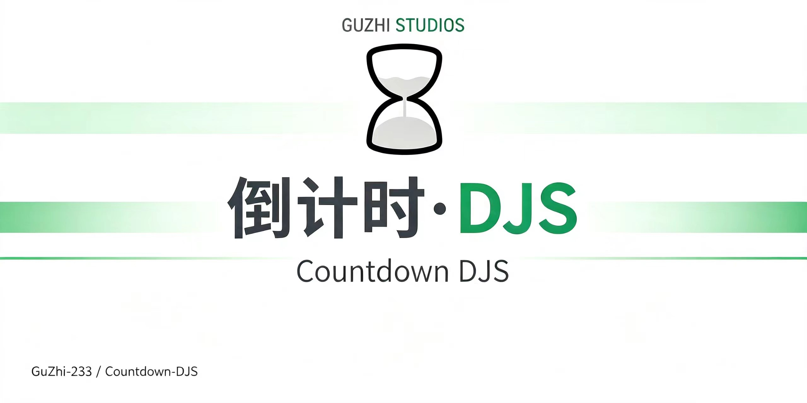
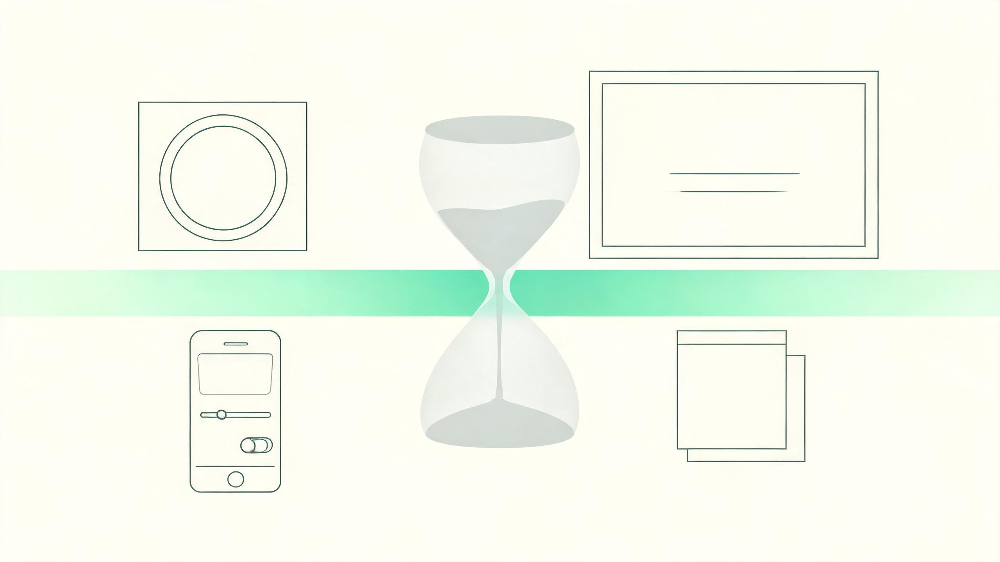
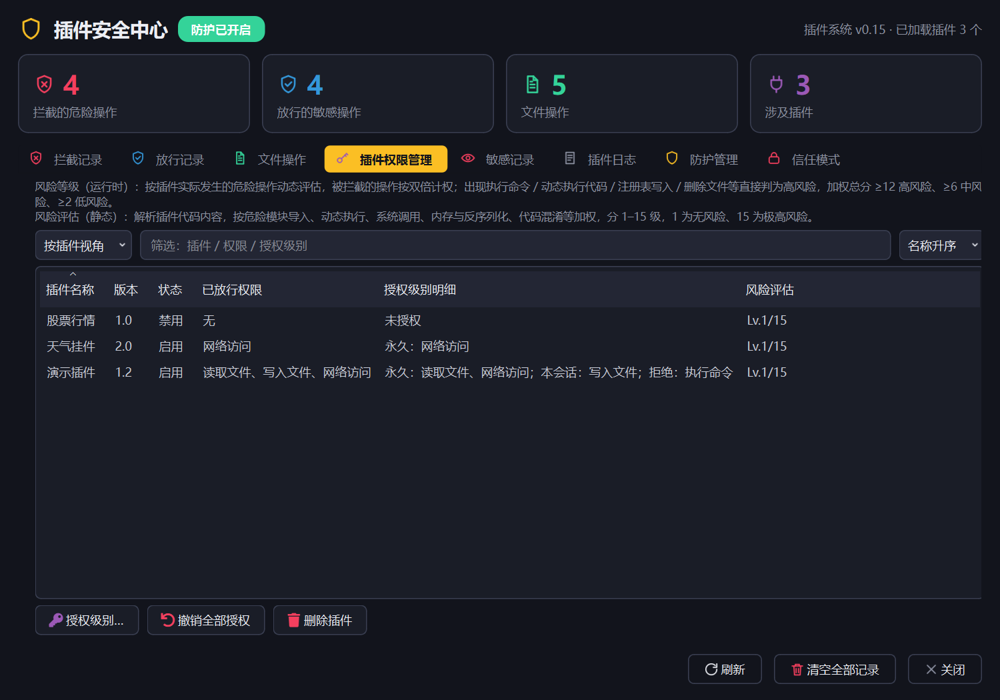
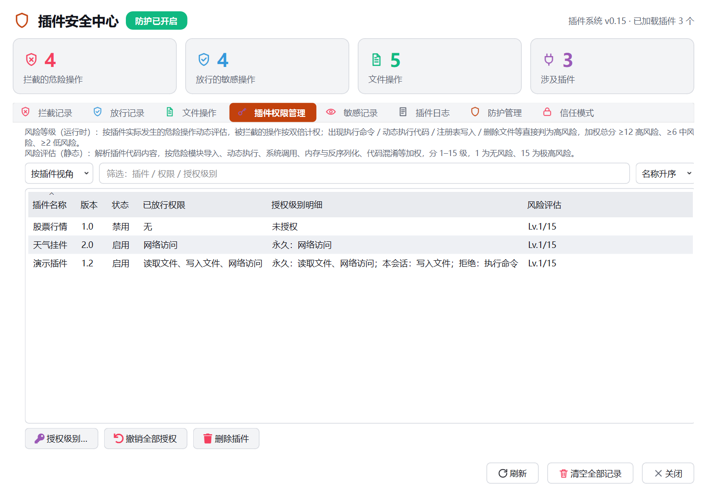

<p align="center">
  
</p>

<p align="center">
  <a href="https://github.com/GuZhi-233/Countdown-DJS/releases/latest"></a>
  <a href="LICENSE"></a>
  
  
</p>

# 倒计时 · DJS

一款基于 **PyQt6** 的 Windows 桌面倒计时工具。它把倒计时放在桌面上，同时提供循环项目、工作日计算、布局编辑器、动态壁纸、全屏沉浸、独立悬浮控件与插件系统。

> 配套的 **ZX 插件**、**Windows / Android 远控控制台** 已拆分到附属仓库：
> **[Countdown-DJS-Addons](https://github.com/GuZhi-233/Countdown-DJS-Addons)**  
> Gitee 镜像：[Countdown-DJS-Addons](https://gitee.com/guzhi233/Countdown-DJS-Addons)

---

## 功能概览

### 多项目倒计时

- 每个项目一个独立悬浮窗，支持目标日期与精确到分钟的时间。
- 自然日 / 工作日双模式，内置中国法定节假日与调休规则。
- 普通倒计时与循环倒计时（每周、每月、每年）两种类型。

### 外观与布局



- 纯色、图片、渐变、动态壁纸、壁纸轮播五种背景。
- 星空、鼠标粒子、极光、天空、潮汐五种动态背景，优先使用 OpenGL + GLSL。
- 可视化布局编辑器：拖拽、缩放、网格吸附、层级调整、键盘微调。
- 窗口材质（玻璃 / 磨砂 / 实底）、透明度、圆角、字体、颜色、描边、阴影。
- 深浅色主题，跟随系统或手动切换。

### 全屏与桌面挂件

- 一键全屏，动态壁纸支持 30 / 60 / 120 帧与四档画质。
- 全屏内直接编辑元素位置、大小、透明度与显隐。
- 天气、番茄钟、诗词三类独立悬浮控件，可自由拖动、缩放、置顶、鼠标穿透。

### 插件与安全

- CAC 插件系统：动态背景、桌面挂件、设置页、卡片插槽、事件钩子。
- 插件运行在独立子进程，权限分为基础权限与按需权限。
- 安全中心记录拦截、放行、文件操作与插件日志，支持信任模式与白名单。

<p align="center">
  
  
</p>


### 教室远程控制

远程控制由附属仓库提供：

- **ZX 插件**：安装在主程序 `plugins` 目录，电脑端监听控制端口并生成配对码。
- **Windows 控制台 / Android 控制台**：一台手机可同时管理多台电脑，分别修改课程表、群发教师通知。
- 支持设备自动重连、设备详情、单台发送与勾选群发。


---

## 下载与安装

| 内容 | 下载 |
| --- | --- |
| 主程序（Windows） | [最新 Release](https://github.com/GuZhi-233/Countdown-DJS/releases/latest) |
| ZX 插件 / Windows 远控 / Android APK | [附属仓库 Release](https://github.com/GuZhi-233/Countdown-DJS-Addons/releases/latest) |

系统要求：

- Windows 10 / 11 x64
- 已安装 Visual C++ 2015-2022 x64 运行库
- 安装包默认安装到当前用户目录，无需管理员权限

安装完成后，双击桌面快捷方式启动主程序。ZX 插件与远控控制台请按附属仓库 README 的步骤安装。

---

## 从源码运行

```bash
git clone https://github.com/GuZhi-233/Countdown-DJS.git
cd Countdown-DJS
pip install -r requirements.txt
python src/djs_pyqt6.py
```

注意：请从仓库根目录运行，程序会在当前目录读取 `data` 静态资源并创建 `plugins` 目录。

可选依赖：

- `numpy`：极光背景的 CPU 回退渲染
- `Pillow`：图片背景增强
- `chinese_calendar`：节假日数据回退
- `psutil`：调试控制台的性能监控命令

---

## 目录结构

```text
Countdown-DJS/
├─ src/djs_pyqt6.py         主程序
├─ data/                    静态资源与默认数据
├─ docs/                    截图、设计文档
├─ tools/                   版本号与打包脚本
├─ archive/legacy/          历史版本主程序
├─ .github/                 Issue / PR 模板
├─ requirements.txt
└─ README.md
```

---

## 开发与打包

升级版本号：

```bash
python tools/bump_version.py 4.5.6
```

构建 Windows 安装包（需要 PyInstaller 与 Inno Setup 6）：

```powershell
powershell -ExecutionPolicy Bypass -File tools/package/build_main.ps1
```

产物输出到 `dist/installer/`：

- `DJS_Setup_<版本>.exe`
- `DJS_Portable_<版本>.zip`

---

## 反馈与贡献

- Gitee Issues（主要）：https://gitee.com/guzhi233/countdown---djs/issues
- GitHub Issues（备用）：https://github.com/GuZhi-233/Countdown-DJS/issues
- 邮箱：guzhiawa@qq.com

提交前请阅读 [CONTRIBUTING.md](CONTRIBUTING.md)。

---

## 更新日志

完整记录见 [CHANGELOG.md](CHANGELOG.md)。

### 4.5.5

- 项目主页迁移到 Gitee 与 GitHub。
- 远控控制台设置页同步列出两个项目主页。
- 帮助中心重写插件开发完整示例。

### 4.5.4

- 帮助中心「插件开发完整示例」重写为可直接运行的课堂提醒插件。
- 修正示例中过时的清单、构造函数与控件注册写法。

---

## 许可证

本项目使用 [MIT License](LICENSE)。

感谢所有反馈问题、提交建议与参与测试的朋友。
